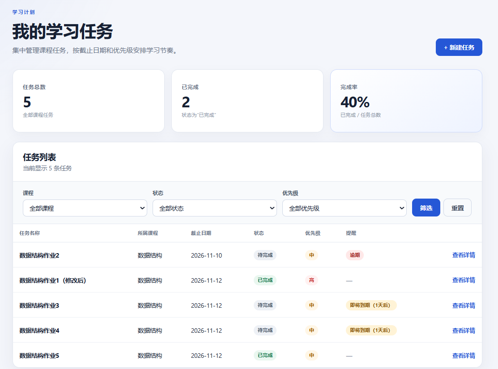

# StudyTask 个人学习任务管理系统

> 《软件工程》实验一：AI 驱动的个人学习任务管理系统  
> Python + Flask + SQLite · 单用户 · 本地 Web 应用 · 中文界面



## 演示与代码仓库

- GitHub 仓库：<https://github.com/hwjing310/StudyTask>
- 本地 Web 地址：<http://127.0.0.1:5000>
- 公网部署入口：<https://render.com/deploy?repo=https://github.com/hwjing310/StudyTask>（登录 Render 后按 Blueprint 创建，部署完成后会生成 `*.onrender.com` 地址）

> 仓库中的 `render.yaml` 已配置构建和启动命令。临时隧道地址不写入仓库，避免失效链接；课程提交时请使用自己部署生成的固定公网地址。

## 功能范围

- 创建任务，服务端校验名称、课程、截止日期、描述长度、优先级和状态。
- 列表展示名称、课程、截止日期、状态、优先级和到期提醒，可进入详情。
- 编辑任务全部字段；修改后列表与详情读取同一份 SQLite 数据。
- 删除前进入独立确认页，确认后从数据库删除。
- 在“待完成 / 进行中 / 已完成”之间调整状态。
- 按课程、状态、优先级筛选，支持组合条件。
- 未完成且截止日期早于今天：显示“逾期”。
- 未完成且截止日期在今天至未来 3 天内：显示“即将到期”。
- 已完成任务不显示逾期/即将到期提醒。
- 首页显示任务总数、已完成数、完成率；0 条任务时完成率为 0%。
- 数据保存在 `instance/studytask.db`，重启应用后保持不变。
- 全中文界面，服务端校验错误回显在表单中，非法输入不会导致崩溃。

范围外：用户注册、多用户权限、共享任务、邮件/短信、第三方日历同步、移动 App、复杂云端功能。未实现超出 SRS 的搜索、标签、通知中心等模块。

## 技术方案

| 项目 | 选择 |
|---|---|
| 语言 | Python 3.10+（本项目在 3.12.14 验证） |
| Web 框架 | Flask 3.1.3 |
| 数据库 | SQLite（标准库 `sqlite3`） |
| 模板/样式 | Jinja2 + 原生 CSS，无 Node.js、无外部 CDN |
| 测试 | pytest 9.2，16 条集成测试 |
| 部署 | Gunicorn；提供 Render Blueprint、Dockerfile、Procfile |
| CI | GitHub Actions：推送/PR 自动运行 pytest |

## 目录结构

```text
studytask/
├─ app.py                       # 启动入口
├─ studytask/
│  ├─ __init__.py               # 应用工厂、404 处理
│  ├─ db.py                     # SQLite 连接、init-db 命令
│  ├─ schema.sql                # tasks 表结构与约束
│  ├─ tasks.py                  # 路由、校验、筛选、提醒、统计
│  ├─ templates/                # 中文列表、表单、详情、删除确认
│  └─ static/style.css          # 本地响应式样式
├─ tests/
│  ├─ conftest.py
│  └─ test_tasks.py             # 16 条自动化测试
├─ docs/
│  ├─ 需求验收表.md
│  ├─ StudyTask_测试记录.docx    # 2026-11-11 初测，16 页，含 16 张实际运行截图
│  ├─ 验收复测记录_2026-11-14.docx # 2026-11-14 独立数据库复测，T1—T10
│  ├─ 实验报告.docx              # 4 页
│  ├─ 演示PPT.pptx               # 8 页
│  ├─ screenshots/              # README/报告/PPT 用图
│  └─ retest/screenshots/       # 复测截图
├─ AI_DEV_LOG.md                # AI 协作过程记录
├─ requirements.txt
├─ render.yaml / Dockerfile / Procfile
└─ .github/workflows/tests.yml
```

## 快速开始

### Windows PowerShell

```powershell
Set-Location H:\temp\studytask
python -m venv .venv
.\.venv\Scripts\python.exe -m pip install -r requirements.txt
.\.venv\Scripts\python.exe -m flask --app app init-db
.\.venv\Scripts\python.exe app.py
```

浏览器访问 <http://127.0.0.1:5000>。

如果已经创建过虚拟环境，只需：

```powershell
Set-Location H:\temp\studytask
.\.venv\Scripts\python.exe app.py
```

### macOS / Linux

```bash
python3 -m venv .venv
source .venv/bin/activate
python -m pip install -r requirements.txt
python -m flask --app app init-db
python app.py
```

说明：

- `python app.py` 默认只监听 `127.0.0.1:5000`。
- 应用首次启动会自动建表；`init-db` 可重复执行，不会清空已有数据。
- 数据库默认位于 `instance/studytask.db`。
- 端口被占用时可设置 `STUDYTASK_PORT`，例如 PowerShell：`$env:STUDYTASK_PORT=8000; python app.py`。
- 清空数据：先停止应用，备份或删除 `instance/studytask.db`，再重新启动。

## 测试

```powershell
.\.venv\Scripts\python.exe -m pytest -q
```

结果：**16 passed**。测试使用临时 SQLite 数据库，不改变正式验收数据。原始输出见 `test-results.txt`，汇总见 `TEST_RESULTS.md`。

测试覆盖：创建与校验、边界值、列表/详情、编辑、删除确认、状态流转、组合筛选、逾期/即将到期、统计、持久化、404、200 条任务规模、init-db 幂等性。

2026-11-14 使用独立数据库和相对当前日期重新执行 T1—T10，结果为 **10/10 通过**，详见 [验收复测记录](docs/验收复测记录_2026-11-14.docx)。

## T1—T10 验收结果

依据实验指导书 2.5 节：

| 用例 | 输入/操作 | 结果 |
|---|---|---|
| T1 | 新建课程“数据结构”、次日截止、高优先级任务 | 通过 |
| T2 | 名称为空提交 | 通过（浏览器 + 服务端双重拦截，无脏数据） |
| T3 | 修改任务描述与优先级 | 通过（刷新后保留） |
| T4 | 待完成 → 进行中 → 已完成 | 通过（逐次持久化） |
| T5 | 分别按课程、状态、优先级筛选 | 通过（结果只含匹配任务） |
| T6 | 新建昨日到期未完成任务 | 通过（显示逾期） |
| T7 | 新建次日到期未完成任务 | 通过（显示即将到期） |
| T8 | 5 项任务、完成 2 项 | 通过（总数 5 / 完成 2 / 40%） |
| T9 | 删除时取消 / 确认 | 通过（取消不删、确认后删除） |
| T10 | 关闭并重新启动系统 | 通过（数据仍可查询） |

- 手工验收：**10/10，100%**
- 2026-11-14 复测：**10/10，100%**
- 自动化回归：**16/16，100%**
- 严重/一般缺陷：**0**
- 详细记录：[需求验收表](docs/需求验收表.md) · [初测记录](docs/StudyTask_测试记录.docx) · [复测记录](docs/验收复测记录_2026-11-14.docx)

## 数据与日期规则

| 字段 | 规则 |
|---|---|
| 任务名称 | 必填，去除首尾空白后 1—100 字符 |
| 所属课程 | 必填，去除首尾空白后 1—60 字符 |
| 任务描述 | 可选，≤1000 字符 |
| 截止日期 | 必填，严格 `YYYY-MM-DD`，且必须是有效日期 |
| 优先级 | 高 / 中 / 低，默认“中” |
| 状态 | 待完成 / 进行中 / 已完成，默认“待完成” |
| 创建/更新时间 | 应用自动记录本地时间 |

- 逾期：`状态 != 已完成` 且 `截止日期 < 今天`
- 即将到期：`状态 != 已完成` 且 `今天 <= 截止日期 <= 今天 + 3 天`
- 已完成不显示以上提醒
- 完成率：`已完成数 / 任务总数`，总数为 0 时显示 `0%`

## 公网部署

### Render Blueprint

仓库包含 `render.yaml`，在 Render 中连接本仓库并创建 Blueprint 即可。启动命令为：

```bash
gunicorn app:app --bind 0.0.0.0:$PORT --workers 1 --threads 4
```

### Docker

```bash
docker build -t studytask .
docker run --rm -p 8000:8000 studytask
```

然后访问 <http://127.0.0.1:8000>。

> 注意：免费云平台的容器文件系统通常不是持久的，重启/重建后 SQLite 数据可能丢失。课程验收的持久化要求在本地环境完成；若需长期公网使用，应挂载持久磁盘或改用托管数据库。

## 提交材料

| 材料 | 位置 |
|---|---|
| 源代码、依赖、启动说明 | 本仓库、`README.md`、`requirements.txt` |
| 需求验收表（T1—T10） | [docs/需求验收表.md](docs/需求验收表.md) |
| 测试记录（16 页/16 图） | [docs/StudyTask_测试记录.docx](docs/StudyTask_测试记录.docx) |
| 不超过 4 页的实验报告 | [docs/实验报告.docx](docs/实验报告.docx) |
| 演示 PPT | [docs/演示PPT.pptx](docs/演示PPT.pptx) |
| AI 协作记录 | [AI_DEV_LOG.md](AI_DEV_LOG.md) |
| 自动化测试 | [tests/test_tasks.py](tests/test_tasks.py) |

## 已知限制

1. 按 SRS 仅支持单用户本地使用，没有登录、多用户权限和共享。
2. 未实现 CSRF Token；应用默认只监听 `127.0.0.1`，若对外部署需补充安全机制。
3. 逾期/即将到期在页面加载时计算，没有后台定时任务或邮件/短信通知。
4. 列表一次显示全部任务，无搜索和分页；已验证 200 条任务规模。
5. 日期使用运行机器的本地时区。
6. 自动化测试为 Flask 路由/模板/SQLite 集成测试；手工浏览器验收和真实 HTTP 冒烟另有记录，未引入浏览器端 E2E 自动化。
7. 免费云平台的 SQLite 持久化受平台文件系统限制，长期公网使用需持久磁盘或托管数据库。

## AI 使用声明

本项目使用 DeepSeek Harness 辅助完成需求转译、代码骨架、测试、文档和 PPT。AI 产出均经过运行、测试和人工验收；关键提示词、发现的问题与人工判断记录在 [AI_DEV_LOG.md](AI_DEV_LOG.md)。未使用真实密钥、个人敏感数据或伪造运行结果。
